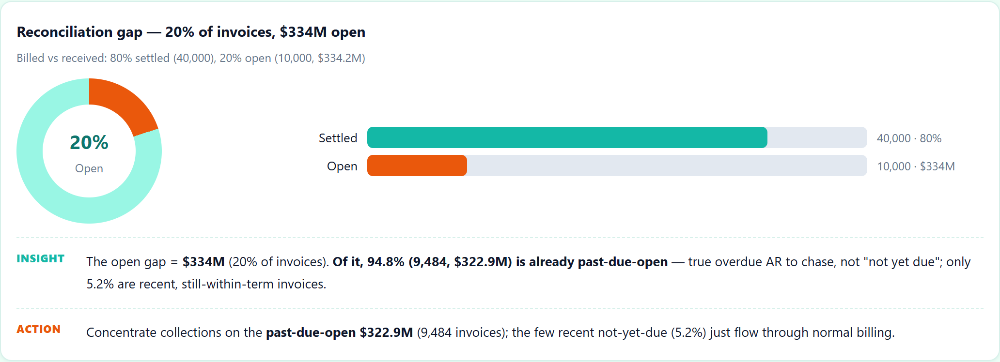
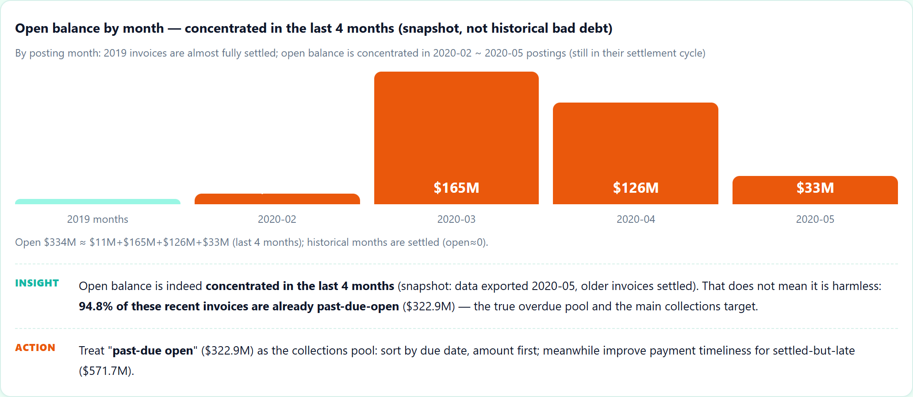
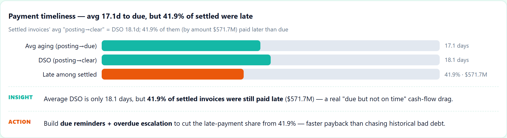
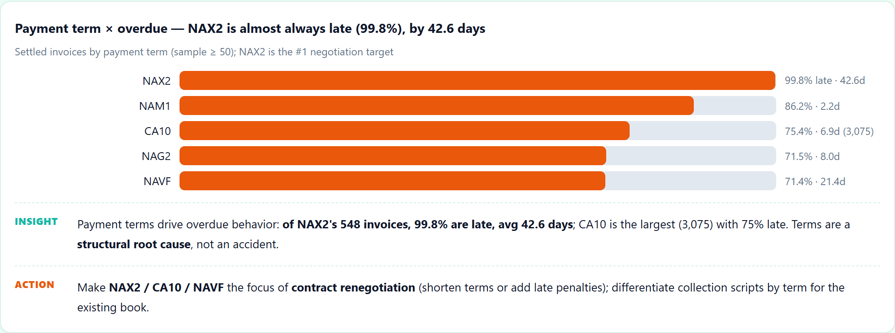
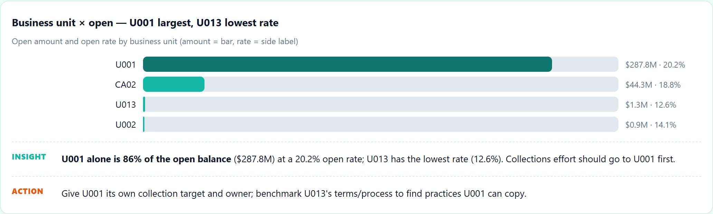

# Accounts Receivable Recovery — Reconciliation & Collections Priority

**The business problem.** An e-commerce / B2B finance team doesn't get paid on
time, and nobody knows *which* unpaid invoices to chase first. Before you can
recover money you have to (a) quantify the gap between "should have been paid"
and "was actually paid", and (b) rank the open invoices so a collections team
can spend its hours where they return the most. This repo does exactly that on
**real** SAP accounts-receivable data.

Runs against the real SAP receivables dataset (`datasets/receivables/dataset.csv`,
50,000 invoice lines, 2018–2020) — not synthetic data.

## What it does

- Cleans a messy real export: drops a fully-empty column, normalizes mixed
  date formats (strings vs numeric `20200210.0`), and proves the label is sound —
  `clear_date` missing ⇔ `isOpen = 1` on **all 50,000 rows**.
- Quantifies the reconciliation gap: **10,000 open invoices (20%) = ~$334M**, of
  which **94.8% (9,484, ~$322.9M) are already past-due** — the real collections
  pool (not "not yet due"). Plus **41.9% of paid invoices were late** (~$571.7M).
- Ranks the **past-due pool** by **priority = amount × probability** (GBM AUC
  0.912 vs logistic baseline 0.67) → a collections queue (top-50 ≈ **$8.0M**,
  all currently open, in the holdout).
- Pinpoints the structural root cause: **payment term NAX2 is late 99.8% of the
  time, 42.6 days** — a negotiation target, not an accident.

## Honest notes (what I did NOT overclaim)

- `isOpen` is a **snapshot** label taken on 2020-05-22: ~92% of the model's signal is `posting_month`, and **94.8% of open invoices are already past-due** (~$322.9M) — the real collections pool; only ~5% are not-yet-due. AUC 0.912 is real, but this is **not** a "bad-debt over time" forecast. The value is the priority queue **over the past-due pool**, not a long-horizon default model.
- **Column note**: `total_open_amount` keeps the source naming — it is the invoice amount and is present on paid invoices too, not "only the open balance".
- **No deep learning used**: 50k rows, plain tabular, no sequence. Gradient
  boosting already hits 0.91 AUC and stays *explainable* (feature importance).
  DL gains little here and hurts the collections narrative — same rule as my
  other projects: only reach for DL when the data is big enough to justify it.
- The reconciliation here is at the **data layer** (billed-vs-paid gap + ranking);
  line-level invoice↔PO↔payment matching needs bank statements, listed as next
  step — not claimed as done.

## Charts







> Full interactive report: open `index.html` (English) or `index.zh-CN.html` (Chinese) after cloning — GitHub doesn't render HTML.

## Layout

```
scripts/
  clean_data.py        # cleaning + derived features + train/val split (stratified)
  analyze.py           # key metrics -> data/output/metrics.json
  ml_analysis.py       # logistic / RF / GBM, priority queue, feature importance
tests/
  test_cleaning.py     # shape, date validity, isOpen⇔clear_date consistency
  test_report_numbers.py  # recompute metrics from parquet, assert HTML matches
index.html        # English interactive report
index.zh-CN.html  # Chinese report, every chart has Insight + Action
```

## Run it

```bash
python -m venv .venv && .venv\Scripts\activate
pip install -r requirements.txt
python scripts/clean_data.py
python scripts/analyze.py
python scripts/ml_analysis.py
pytest tests/ -q
```

## Key verified numbers

- 50,000 lines / 48,833 invoices / ~$1.62B AR; open rate 20% ($334M), of which **94.8% past-due ($322.9M)**; DSO 18.1d
- Paid-but-late rate 41.9% ($571.7M); worst term NAX2 99.8% late, 42.6d
- Models (holdout): logistic AUC 0.669 / RF 0.908 / **GBM 0.912**
- Holdout past-due pool 2,000 / $68.1M; collections queue top-50 ≈ $8.0M

## Data source

The raw file lives in `data/raw/` (excluded from git — after cloning, download it yourself).

| File | What it is | Kaggle download |
|---|---|---|
| `dataset.csv` | Real SAP accounts-receivable snapshot (50,000 invoice lines, 2018–2020) | `kaggle datasets download -d mustafakeser4/sap-dataset-bigquery-dataset -p data/raw --unzip` |

Kaggle pages (closest public AR / payment-term sources):
- https://www.kaggle.com/datasets/mustafakeser4/sap-dataset-bigquery-dataset (SAP enterprise finance/procurement)
- https://www.kaggle.com/datasets/hhenry/finance-factoring-ibm-late-payment-histories (AR / payment-term, same shape)

Honest note: this repo uses a real SAP AR extract; the Kaggle links are the closest reproducible public sources with the same AR/term structure.

```bash
pip install kaggle
kaggle datasets download -d mustafakeser4/sap-dataset-bigquery-dataset -p data/raw --unzip
# requires a kaggle.json / KAGGLE_USERNAME + KAGGLE_KEY
```

— Jiawei Wang
