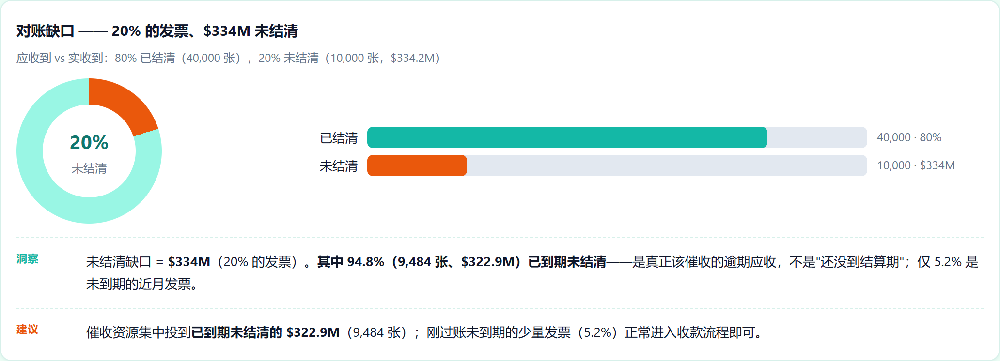
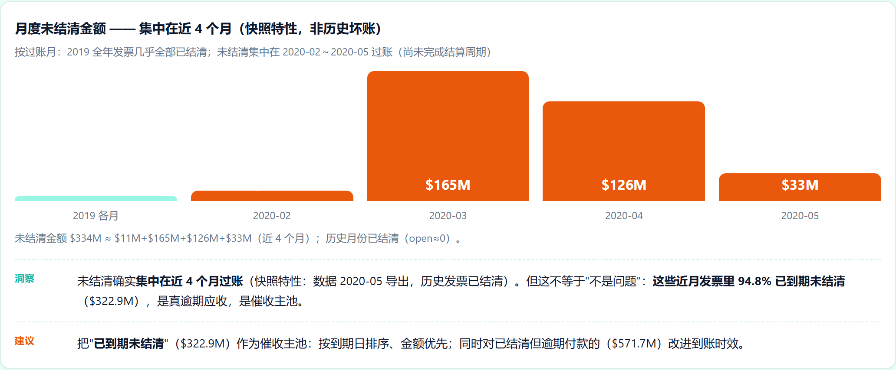
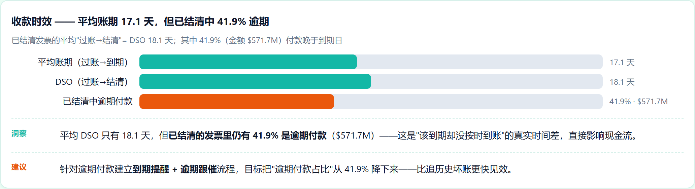
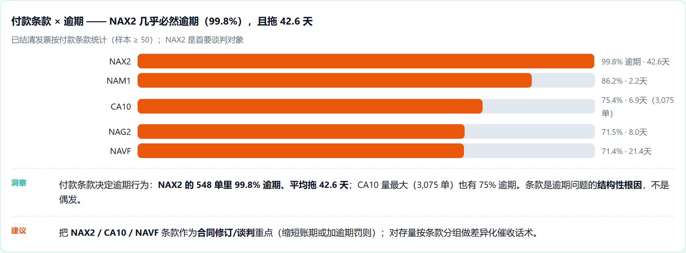
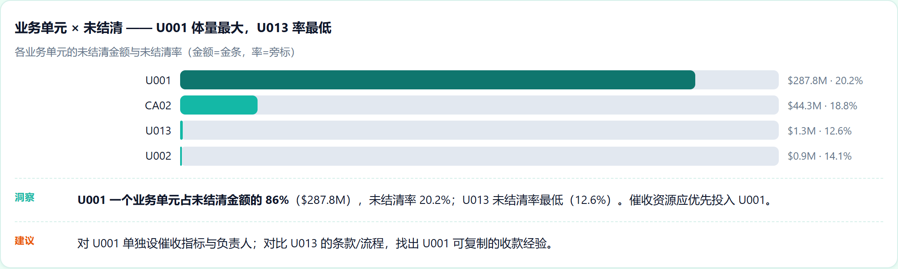

# 应收账款回收与催收优先级（Accounts Receivable Recovery & Collections Priority）


> 项目目标：在真实 SAP 应收账款数据上量化"应该收到 vs 实际收到"的缺口，并把未结发票按"值得先催"排序成催收队列，让催收团队把时间花在回报最高的地方。
> 数据：真实 SAP 应收账款快照（50,000 行发票，2018–2020，应收合计约 **$1.62B**）。

## 一、业务背景与目的

电商/B2B 财务团队常常不能按时收到钱，却不知道**该先追哪些**。要收回钱，必须先(a)量化"应该已付 vs 实际已付"的缺口，再(b)把未结发票排序成队列，让催收团队把精力投在回报最高的地方。本项目在真实 SAP 数据上做这件事，并证明标签可靠。

## 二、数据清洗与预处理

- 清洗脏乱的真实导出：删除整列全空的列，统一混合日期格式（字符串 vs 数值 `20200210.0`）。
- **证明标签可靠**：`clear_date` 缺失 ⇔ `isOpen = 1`，在全部 50,000 行上成立。
- 派生：到期天数 / 结清天数 / 逾期天数 / 金额对数；按 posting_date 前 80% 训练、后 20% 验证（分层、防泄漏）。

## 三、关键指标

| 指标 | 数值 |
|---|---|
| 规模 | 50,000 行 / 48,833 张发票 / ~$1.62B 应收 |
| 未结缺口 | **10,000 张（20%）= ~$334M** |
| 其中已逾期 | **94.8%（9,484 张，~$322.9M）** —— 这才是真正的催收池（不是"未到期"） |
| 已付但逾期 | 41.9%（~$571.7M） |
| DSO | 18.1 天 |

**关键洞察**：`isOpen` 是 2020-05-22 的快照标签，94.8% 的未结其实已逾期——价值在**逾期池的优先级队列**，而不是长期坏账预测。

## 四、建模

- 在**逾期未结池**上用 优先级 = 金额 × 概率 排序：**GBM AUC 0.912**（对比逻辑回归基线 0.67、RF 0.908）→ 输出催收队列（holdout 前 50 ≈ **$8.0M**，全部当前未结）。
- 根因定位：付款条款 **NAX2 逾期率 99.8%、平均逾期 42.6 天**——是谈判/条款修改目标，不是偶然。

**为什么不用深度学习**：5 万行、普通表格、无序列；梯度提升已到 0.91 AUC 且保持可解释（特征重要性）。DL 在这里增益极小，反而伤害"催收必须可解释"的叙事——与我其他项目同一规则：只在数据大到值得时才用 DL。

## 五、图表







> 完整交互版报告：`report/应收对账分析报告.html`——GitHub 不渲染仓库内 HTML，clone 后本地打开。

## 六、数据来源

原始数据在项目内 `data/raw/`（不入 git——clone 后请自行下载）。

| 文件 | 说明 | Kaggle 下载 |
|---|---|---|
| `dataset.csv` | 真实 SAP 应收账款快照（50,000 行发票，2018–2020） | `kaggle datasets download -d mustafakeser4/sap-dataset-bigquery-dataset -p data/raw --unzip` |

Kaggle 页面（最接近的公开 AR/账期数据源）：
- https://www.kaggle.com/datasets/mustafakeser4/sap-dataset-bigquery-dataset（SAP 企业财务/采购）
- https://www.kaggle.com/datasets/hhenry/finance-factoring-ibm-late-payment-histories（应收/账期，结构相近）

诚实说明：本仓库用的是真实 SAP AR 导出；上述 Kaggle 链接是具有相同 AR/账期结构、可复现的最接近公开源。

```bash
pip install kaggle
kaggle datasets download -d mustafakeser4/sap-dataset-bigquery-dataset -p data/raw --unzip
# 需要 kaggle.json / KAGGLE_USERNAME + KAGGLE_KEY 认证
```

## 七、运行方式

```bash
pip install -r requirements.txt
python scripts/clean_data_simple.py      # 清洗 + 派生特征 + 分层训练/验证切分
python scripts/analyze_simple.py         # 关键指标 -> data/output/metrics.json
python scripts/ml_analysis_simple.py     # 逻辑回归 / RF / GBM、优先队列、特征重要性
pytest tests/ -q
```

## 八、诚实边界

- 对账在**数据层**（已出账单-已收账缺口 + 排序）；行级 invoice↔PO↔payment 匹配需银行对账单，列为下一步、不冒充已完成。
- 这是**逾期池的优先级队列**，不是随时间的坏账预测。

— Jiawei Wang

## CI / 质量门

每次 push 或拉取请求都会触发 [GitHub Actions](.github/workflows/ci.yml) 工作流：质量门检查「英文文档不含中文、引用的图表都存在、中英 README 与 index 齐全」，随后运行 `pytest` 测试套件。


